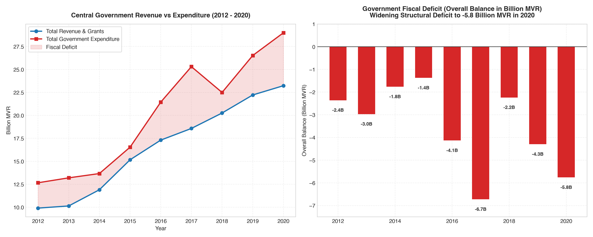

# Exploratory Data Analysis: Statistical Yearbook of Maldives 2021
### An Empirical Analysis of Demographics, Macroeconomics, Tourism, Fisheries, and Infrastructure

---

## Executive Summary

The **Statistical Yearbook of Maldives 2021**, published by the **National Bureau of Statistics (NBS)**, offers an unprecedented empirical window into the socio-economic and environmental fabric of the Republic of Maldives. This repository provides **303 clean, tabular CSV datasets** and companion JSON metadata spanning **20 thematic chapters**.

This exploratory data analysis synthesizes decades of historical baselines (2000–2019) against the unprecedented disruption of the **2020 COVID-19 pandemic**. Key high-level takeaways include:

1. **Extreme Urban Primacy & Spatial Disparity**: Malé Island concentrates **153,904 residents (39.4% of the national total)** onto just **2.05 km²**, generating a population density of **74,879 people/km²**—among the highest globally—while the median inhabited island holds merely **1,009 residents**.
2. **Unprecedented Macroeconomic Shock**: Real GDP (at 2014 constant prices) contracted by **-33.5% in 2020** (falling from 77.1 billion MVR to 51.3 billion MVR). This was **2.5× more severe than the 2004 Indian Ocean Tsunami** (-13.1%) and **4.6× the 2008 Global Financial Crisis** (-7.2%).
3. **Tourism Collapse & Structural Market Pivot**: Annual tourist arrivals collapsed by **-67.4%** from a record **1,702,887 in 2019** to **555,494 in 2020**. With the border closed from March 27 to July 15, Q2 saw only **55 total arrivals**. Following reopening, a rapid winter rebound was driven by **India (62,960)** and **Russia (61,387)**, completely displacing the former leading market, **China** (34,245).
4. **Counter-Cyclical Buffer of the Blue Economy**: While tourism and construction plunged (-62.5% and -33.8% respectively), the **Fisheries sector expanded by +10.2%**, logging a record catch of **148,583 metric tons** in 2020, driven by a surge in pole-and-line **Skipjack Tuna (103,871 MT)**. Over **70.8% of the catch was exported**, anchoring domestic food security and foreign exchange earnings.
5. **Widening Fiscal Imbalances**: Central government revenue dropped sharply, while emergency health and social expenditures drove the overall deficit to **-5,763 million MVR** (or **-18,077 million MVR** including project financing and debt obligations).
6. **Archipelagic Environmental Friction**: Between **70 and 90 inhabited islands** routinely exhaust their freshwater reserves during the dry season, requiring sea-transported emergency water. The average logistical cost per ton escalated from **750 MVR in 2007** to over **2,750 MVR in 2020**.

---

## 1. Dataset Landscape & Catalog Architecture

The dataset catalog (`datasets/catalog.json`) indexes **303 distinct tables** across 20 chapters.

| Domain | Chapters Included | Tables | Focus Areas |
| :--- | :--- | :---: | :--- |
| **Macro & External Economy** | Tourism, Public Finance, Money & Banking, Foreign Trade, National Accounts, Prices | **81** | GDP by economic activity, tourist arrivals, balance of payments, inflation, fiscal budget |
| **Social & Demographics** | Population, Health, Education, Law & Order, Pension & Social, Human Rights, Elections | **143** | Census records, mortality, hospital staff, school enrollment, court cases, voter turnout |
| **Productive Sectors** | Fisheries & Agriculture, Employment | **30** | Tuna catch by species, farmer registry, labor permits, expatriate workforce |
| **Infrastructure & Utilities**| Transport & Communication, Electricity & Water, Housing | **39** | Airport movements, vehicle registrations, desalination volumes, emergency water |
| **Environment & Geography** | Geography, Environment | **10** | Meteorological observations (rainfall, sunshine), island land areas, environmental indicators |


---

## 2. Geography & Extreme Capital Primacy

Analysis of **Table 1.5** (`datasets/1.0 Geography/1.5.csv`) reveals stark spatial inequality across the Maldives' 190 inhabited administrative localities:

### Key Demographic Findings:
- **Total Resident Population (Census 2014)**: 390,584 persons across 190 islands.
- **Capital Primacy**:
  - **Malé Island**: 153,904 residents (39.4% of national population) on 205.5 hectares (2.05 km²).
  - **Greater Malé Conurbation** (Malé + Hulhumalé + Villingili): 179,041 residents (**45.8%** of the national population) on ~651 hectares.
- **Population Density Extreme**:
  - **Malé**: **74,879 persons/km²** (748.8 persons/hectare).
  - **Villingili**: **24,563 persons/km²**.
  - **Outer Atoll Island Median**: **1,980 persons/km²** (19.8 persons/hectare).
- **Island Size Distribution**: The median outer island has a resident population of just **1,009 people**. Over 55% of inhabited islands have fewer than 1,000 residents.


### Analytical Implication:
This extreme spatial concentration concentrates economic output, financial services, and tertiary hospitals in Malé, but creates profound challenges in housing affordability, congestion, and vulnerability to disease transmission. Concurrently, it creates steep per-capita costs for delivering desalination, power generation, secondary schools, and specialized healthcare across the 187 outer islands.

---

## 3. The Tourism Engine & The 2020 COVID-19 Shock

Tourism is the cornerstone of the Maldivian economy, generating foreign exchange and anchoring the services sector. Analysis of **Table 10.1** and **Table 10.11** charts the sector's trajectory:

### Key Tourism Metrics (2012–2020):

| Year | Total Arrivals | YoY Growth (%) | Bed Capacity (Resorts) | Top Source Market |
| :---: | :---: | :---: | :---: | :---: |
| **2012** | 958,025 | — | 22,784 | China (229,551) |
| **2015** | 1,234,248 | +2.4% | 26,099 | China (359,514) |
| **2017** | 1,389,542 | +8.0% | 29,401 | China (306,530) |
| **2019** | **1,702,887** | **+14.7%** | 33,678 | China (284,029) |
| **2020** | **555,494** | **-67.4%** | 34,706 | **India (62,960)** |


### The 2020 Pandemic Dynamics:
1. **The Border Lockdown**: The Maldivian border was completely closed on **27 March 2020**. Between April and June 2020, foreign arrivals collapsed to near absolute zero:
   - April 2020: **13 arrivals**
   - May 2020: **41 arrivals**
   - June 2020: **1 arrival**
2. **Rapid Post-Lockdown Reopening**: On **15 July 2020**, the Maldives became one of the first countries in the world to reopen to international tourists without mandatory quarantine, leveraging the natural "one island, one resort" geographic isolation.
3. **The Winter Rebound**: Arrivals accelerated exponentially:
   - July: 1,752 | August: 7,636 | September: 9,605 | October: 21,515 | November: 35,757 | **December: 96,412**.
4. **Structural Market Transformation**:
   - **China**: Plunged from 284,029 (16.7% share) in 2019 to 34,245 (almost entirely before February 2020).
   - **India**: Rose to **#1** with 62,960 tourists (11.3% share), facilitated by an air travel bubble.
   - **Russia**: Rose to **#2** with 61,387 tourists (11.1% share), driving high-yield luxury resort occupancy.

---

## 4. Macroeconomic Trajectory: Real GDP & Sectoral Performance

Analysis of **Table 16.1** (`datasets/16.0 National Accounts/16.1.csv`) evaluates Real Gross Domestic Product at **2014 Constant Prices** from 2003 through 2020.

### Historical Crisis Comparison:
- **2004 Indian Ocean Tsunami**: Real GDP contracted by **-13.1%** in 2005 (falling from 34.5B to 30.0B MVR).
- **2008 Global Financial Crisis**: Real GDP contracted by **-7.2%** in 2009 (falling from 44.6B to 41.4B MVR).
- **2020 COVID-19 Pandemic**: Real GDP plummeted by **-33.5%** (falling from **77.08 billion MVR to 51.26 billion MVR**), making it the single largest contraction in recorded modern Maldivian history.


### 2020 Sectoral Breakdown:
| Economic Sector | 2019 GVA (MVR M) | 2020 GVA (MVR M) | YoY Change (%) | Structural Driver |
| :--- | :---: | :---: | :---: | :--- |
| **Tourism** | 20,271.0 | 7,597.1 | **-62.5%** | International aviation & resort shutdowns |
| **Transportation & Comm.** | 9,719.1 | 5,537.6 | **-43.0%** | Grounding of seaplanes & domestic flights |
| **Wholesale & Retail Trade** | 6,126.1 | 3,840.1 | **-37.3%** | Lower consumer demand & import compression |
| **Construction** | 5,111.0 | 3,381.7 | **-33.8%** | Supply chain disruption & migrant labor lockdowns |
| **Manufacturing** | 1,686.1 | 1,335.2 | **-20.8%** | Reduced domestic fabrication |
| **Public Administration** | 6,507.5 | 6,565.2 | **+0.9%** | Public sector wage maintenance |
| **Financial Services** | 3,203.4 | 3,488.5 | **+8.9%** | Emergency liquidity & banking operations |
| **Fisheries** | 2,342.7 | 2,581.1 | **+10.2%** | Record catch & strong canned tuna export demand |

---

## 5. Public Finance & Debt Dynamics

Analysis of **Table 13.1**, **Table 13.2**, and **Table 10.10** reveals the fiscal mechanisms of the state budget:

- **Revenue Contraction**: Total central government revenue (excluding grants) contracted sharply as tourist GST, airport taxes, and import customs duties dwindled.
- **Expenditure Rigidity**: Total expenditure rose from **26,522M MVR in 2019** to **28,995M MVR in 2020** as the state funded health infrastructure, quarantine centres, income support allowances, and utility subsidies.
- **Deficit Explosion**: The primary and overall balance widened to **-5,763 million MVR** (central government format) and **-18,077 million MVR** under the total budgetary framework, accelerating public debt accumulation.



---

## 6. Fisheries & The Resilient Blue Economy

Fisheries remains the bedrock of traditional livelihood, employment across the atolls, and merchandise exports. Analysis of **Table 9.1** and **Table 9.6** shows remarkable resilience:

- **Record 2020 Catch**: Total fish production reached **148,583 metric tons** in 2020—the highest catch on record for the decade (+10.0% over 2019).
- **Species Composition**:
  - **Skipjack Tuna (*Katsuwonus pelamis*)**: **103,871 MT (69.9%)**, up from 88,020 MT in 2019.
  - **Yellowfin Tuna (*Thunnus albacares*)**: **42,705 MT (28.7%)**.
  - Other marine species: 2,008 MT (1.4%).
- **Export Orientation**: **70.8% of the total catch was exported** in 2020 (as canned tuna, frozen whole round, and dried fish), proving that artisanal pole-and-line tuna fisheries can remain operational and profitable during global travel standstills.


---

## 7. Climate, Environment & Water Security

As a low-lying coral atoll nation, the Maldives faces severe environmental and freshwater constraints. Analysis of **Table 12.15** (`datasets/12.0 Electricity and water/12.15.csv`) captures this acute vulnerability:

- **Dry Season Water Crises**: Every year during the northeast monsoon (Iruvai), shallow island freshwater lenses become saline or dry up. Between **70 and 91 inhabited islands** (over one-third of all populated islands) run completely out of drinkable water and require emergency water shipments.
- **Logistical Cost Escalation**:
  - In 2005, transporting emergency water cost **900 MVR per ton**.
  - In 2007, it was **750 MVR per ton**.
  - By 2017–2020, the cost escalated to **2,750 – 2,920 MVR per ton**, with annual emergency water budgets reaching **9 to 11 million MVR**.
- **Underlying Cause**: Water must be produced via desalination in central hubs and loaded onto transport barges or naval vessels to navigate shallow atoll passages, demonstrating the high energy and transport penalties of archipelagic geography.


---

## 8. Developer & Researcher Guide

For analysts, economists, and data scientists looking to build models or applications on this repository:

### Directory & File Structure:
```text
statistical-year-book-2021/
├── datasets/
│   ├── catalog.json                       # Master index of all 303 tables with metadata
│   ├── README.md                          # Full table of contents with descriptions
│   ├── 1.0 Geography/                     # Tables 1.1 to 1.5 (.csv + .json)
│   ├── 10.0 Tourism/                      # Tables 10.1 to 10.15 (.csv + .json)
│   ├── 13.0 Public Finance/               # Tables 13.1 to 13.13 (.csv + .json)
│   ├── 16.0 National Accounts/            # Tables 16.1 to 16.17 (.csv + .json)
│   └── ... (20 thematic directories)
├── figures/                               # Generated publication-quality figures (PNG)
├── notebooks/
│   └── exploratory_data_analysis.ipynb   # Interactive analysis notebook
├── scripts/
│   ├── generate_eda_visualizations.py    # Generates all 7 visualization figures
│   └── build_eda_notebook.py             # Notebook generation pipeline
├── EXPLORATORY_DATA_ANALYSIS.md          # Comprehensive analytical report
└── requirements.txt                      # Python dependencies (pandas, matplotlib, seaborn)
```

### Loading Data with Python & Pandas:
```python
import json
import pandas as pd

# 1. Search the catalog for relevant tables
with open('datasets/catalog.json') as f:
    catalog = json.load(f)

# Find all tables related to 'fish' or 'exports'
relevant = [t for t in catalog if 'fish' in t['title_en'].lower() or 'export' in t['title_en'].lower()]
for r in relevant[:5]:
    print(f"[{r['table_id']}] {r['title_en']} -> datasets/{r['csv_file']}")

# 2. Read any table directly
df_gdp = pd.read_csv('datasets/16.0 National Accounts/16.1.csv')
print(df_gdp.head())
```

### Key Data Quirks to Note:
1. **Public Finance Denominations**: In Table 13.1, historical years prior to 2019 report in millions of MVR (e.g., 22,336), whereas 2019 and 2020 values are recorded in raw MVR (e.g., 22,008,821,726). Always check the companion metadata JSON for the exact unit definition or normalize by 1,000,000.
2. **Special Characters in Island Names**: Island names in Table 1.5 often end with an asterisk (`*`) to denote administrative atoll capitals (e.g., `Dhidhdhoo *`, `Thinadhoo *`). Strip asterisks using `.str.replace('*', '').str.strip()`.
3. **Footnotes in Column Names**: Column headers occasionally include statistical note notations like `1_/` or `2_/` (e.g., `2018 2_/`). These can be cleanly stripped or regex-parsed for time-series operations.

---

## Citation & Acknowledgments
- **Source**: National Bureau of Statistics (NBS), Ministry of National Planning, Housing and Infrastructure, Republic of Maldives.
- **Publication**: Statistical Yearbook of Maldives 2021.
- **Dataset Conversion**: Extracted and standardized into clean UTF-8 CSVs with metadata.
