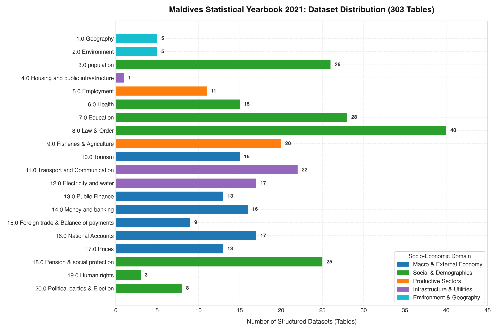
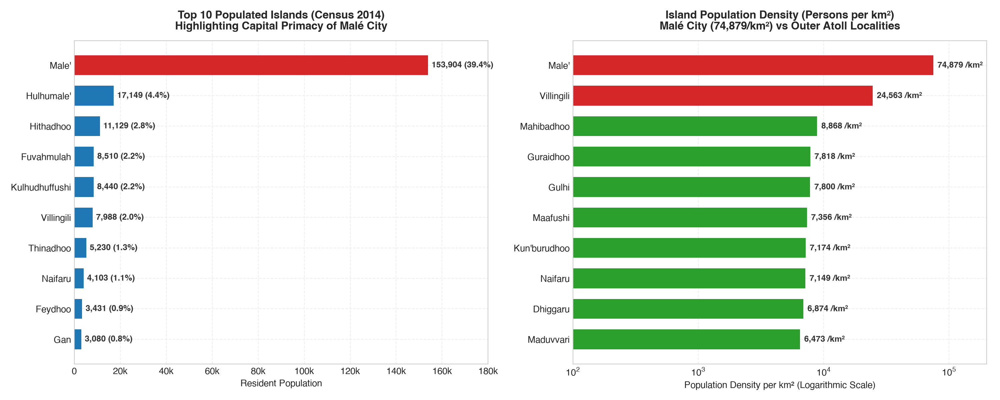
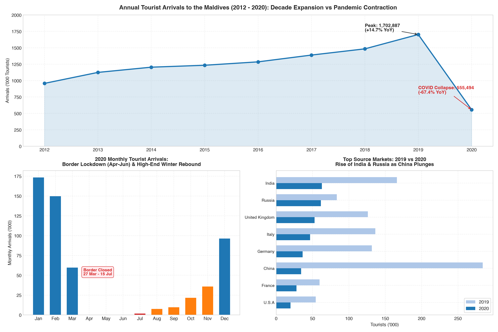
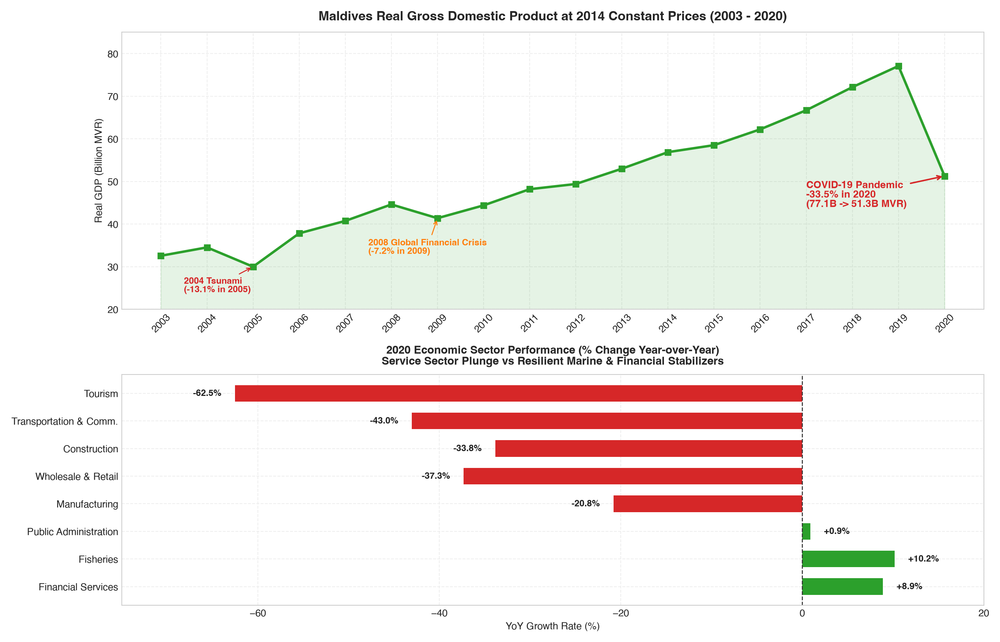
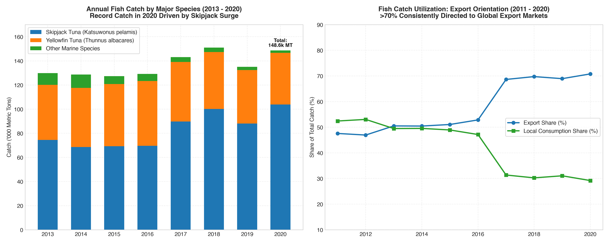
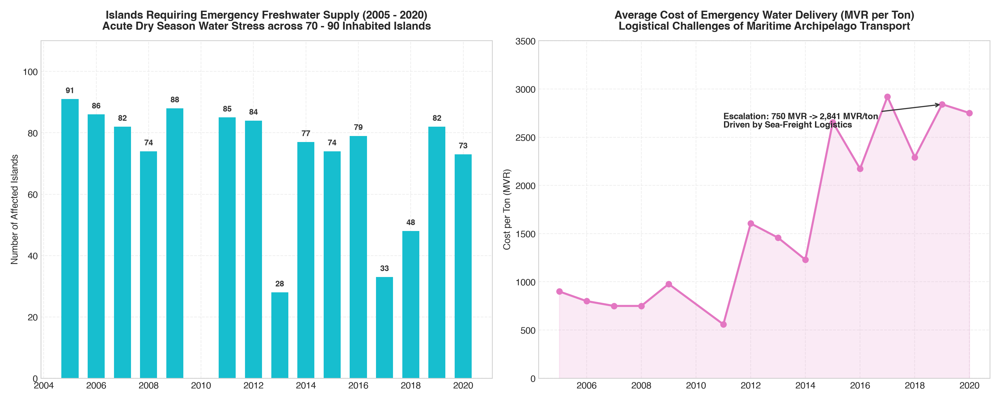

# Statistical Yearbook 2021 Maldives — Interactive Dashboard & Analysis

[](https://ajmals.github.io/maldives-statistics-2021/)
[](datasets/)
[](datasets/catalog.json)
[](datasets/indicators/)
[](EXPLORATORY_DATA_ANALYSIS.md)
[](requirements.txt)

> 🚀 **Live Interactive Web Application**: [https://ajmals.github.io/maldives-statistics-2021/](https://ajmals.github.io/maldives-statistics-2021/)

A complete, machine-readable, open-data repository and interactive dashboard of the **Statistical Yearbook of Maldives 2021**, originally published by the **National Bureau of Statistics (NBS)**, Maldives.

This repository transforms the official annual statistical compendium into **309 clean, tabular UTF-8 CSV datasets** with structured JSON metadata, accompanied by **18 Indicator datasets** (including Poverty), an **Interactive Web Dashboard hosted live on GitHub Pages**, extensive **Exploratory Data Analysis (EDA)**, interactive Jupyter Notebook, and visualization figures.

---

## 🌐 Live Interactive Dashboard

Explore the interactive web application directly in your browser:  
👉 **[https://ajmals.github.io/maldives-statistics-2021/](https://ajmals.github.io/maldives-statistics-2021/)**

The dashboard is built with HTML5, Vanilla CSS3, modern JavaScript, and Chart.js, requiring zero backend or complex build pipeline.

### 🌟 Key Features:
- **Zero-Build Deployment**: Hosted live via GitHub Pages directly from the repository.
- **Global Benchmarking Suite**: Directly contrasts Maldives data against international indicators (Paris, Manhattan, Manila, Tokyo, Spain, Iceland, World averages).
- **Curated Trivia & Interesting Facts**: Interactive categorized flashcards revealing geographic, economic, and demographic extremes.
- **Dynamic Chart Suite**: Interactive radar, line, bar, and doughnut charts with dark/light mode toggle.
- **190-Island Interactive Directory**: Live search and sort across all 190 inhabited localities by population, land area, density, and distance to Malé.
- **309-Table Master Catalog Explorer**: Filter by chapter or search any table to immediately access and download clean CSVs.

---

## 📊 Key Highlights & Exploratory Data Analysis

A detailed empirical investigation is available in **[`EXPLORATORY_DATA_ANALYSIS.md`](EXPLORATORY_DATA_ANALYSIS.md)** and the **[`notebooks/exploratory_data_analysis.ipynb`](notebooks/exploratory_data_analysis.ipynb)** notebook.

### Core Empirical Findings:
- **Primate City Density**: Malé Island concentrates **153,904 residents (39.4% of national population)** onto **2.05 km²**, reaching a world-leading density of **74,879 people/km²** (vs a median of 1,009 residents on outer atoll islands).
- **The 2020 COVID-19 Macro Shock**: Real GDP contracted by **-33.5%** in 2020 (77.1B MVR down to 51.3B MVR)—more than **2.5× the impact of the 2004 Tsunami** (-13.1%) and **4.6× the 2008 Global Financial Crisis** (-7.2%).
- **Tourism Collapse & Geopolitical Rebound**: Annual tourist arrivals fell by **-67.4%** (from 1.70M in 2019 to 555k in 2020). Border closure in Q2 saw just 55 arrivals, followed by a rapid winter recovery led by **India (62,960)** and **Russia (61,387)**, displacing **China** (plunging from 284k to 34k).
- **The Blue Economy Stabilizer**: While service sectors halted, the **Fisheries sector expanded by +10.2%**, landing a record **148,583 metric tons** of fish (led by **103,871 MT of Skipjack Tuna**), with **70.8% exported**.
- **Freshwater Scarcity**: Between **70 and 91 inhabited islands** exhaust their freshwater reserves during the dry season, requiring emergency maritime water deliveries at an average cost of **2,750+ MVR per ton**.

---

## 📁 Repository Structure

```text
statistical-year-book-2021/
├── index.html                             # Interactive Web Dashboard UI
├── app.js                                 # Dashboard state, search, and Chart.js logic
├── styles.css                             # Dark/light theme & responsive styling
├── dashboard_data.js                      # Pre-bundled dashboard dataset & catalog
├── datasets/                              # 309 clean CSV datasets organized in 20 chapters + Indicators
│   ├── catalog.json                       # Master schema & metadata index
│   ├── README.md                          # Comprehensive table of contents
│   ├── indicators/                        # 18 thematic indicator summaries (incl. Poverty)
│   ├── 1.0 Geography/                     # Sunshine, rainfall, land area, population density
│   ├── 10.0 Tourism/                      # Tourist arrivals by market/month, bed capacity
│   ├── 13.0 Public Finance/               # Revenue, expenditure, foreign debt, grants
│   ├── 16.0 National Accounts/            # Real GDP (2003-2020), sectoral GVA, growth rates
│   └── ... (20 chapters total)
├── figures/                               # Publication-grade visualization figures (PNG)
│   ├── fig1_catalog_breakdown.png
│   ├── fig2_geographic_concentration.png
│   ├── fig3_tourism_shock_2020.png
│   ├── fig4_gdp_structural_shock.png
│   ├── fig5_public_finance_deficit.png
│   ├── fig6_fisheries_production_utilization.png
│   └── fig7_emergency_water_vulnerability.png
├── notebooks/
│   └── exploratory_data_analysis.ipynb   # Interactive analysis Jupyter Notebook
├── scripts/
│   ├── generate_eda_visualizations.py    # Figure generation pipeline
│   └── build_eda_notebook.py             # Notebook generation pipeline
├── EXPLORATORY_DATA_ANALYSIS.md          # Full in-depth research report
├── requirements.txt                      # Python dependencies
└── README.md                             # Repository overview
```

---

## 🚀 Quickstart & Usage

### 1. Installation
Clone the repository and install dependencies in a virtual environment:
```bash
git clone https://github.com/ajmals/maldives-statistics-2021.git
cd maldives-statistics-2021

python3 -m venv .venv
source .venv/bin/activate
pip install -r requirements.txt
```

### 2. Loading Datasets with Python & Pandas
Every table is stored in clean CSV format alongside a `.json` companion holding original units, Dhivehi titles, notes, and sources:

```python
import json
import pandas as pd

# Load master catalog
with open('datasets/catalog.json') as f:
    catalog = json.load(f)

# Find any table by keyword
tour_tables = [t for t in catalog if 'tourist' in t['title_en'].lower()]
print(f"Found {len(tour_tables)} tourism datasets.")

# Load Real GDP data
df_gdp = pd.read_csv('datasets/16.0 National Accounts/16.1.csv')
print(df_gdp.head())
```

### 3. Re-generating Analysis Visualizations
To re-run the analysis and re-generate all 7 figures in `figures/`:
```bash
python scripts/generate_eda_visualizations.py
```

---

## 📈 Visual Gallery

| Catalog Distribution | Island Population Density |
| :---: | :---: |
|  |  |

| Tourism COVID Shock & Rebound | Real GDP Trajectory (2003-2020) |
| :---: | :---: |
|  |  |

| Fisheries Production & Exports | Emergency Island Freshwater Logistics |
| :---: | :---: |
|  |  |

---

## 📜 Citation & Attribution
- **Data Source**: National Bureau of Statistics (NBS), Ministry of National Planning, Housing and Infrastructure, Republic of Maldives.
- **Publication**: *Statistical Yearbook of Maldives 2021*.
- **Licensing**: Data is published under open statistical access terms by the NBS.
