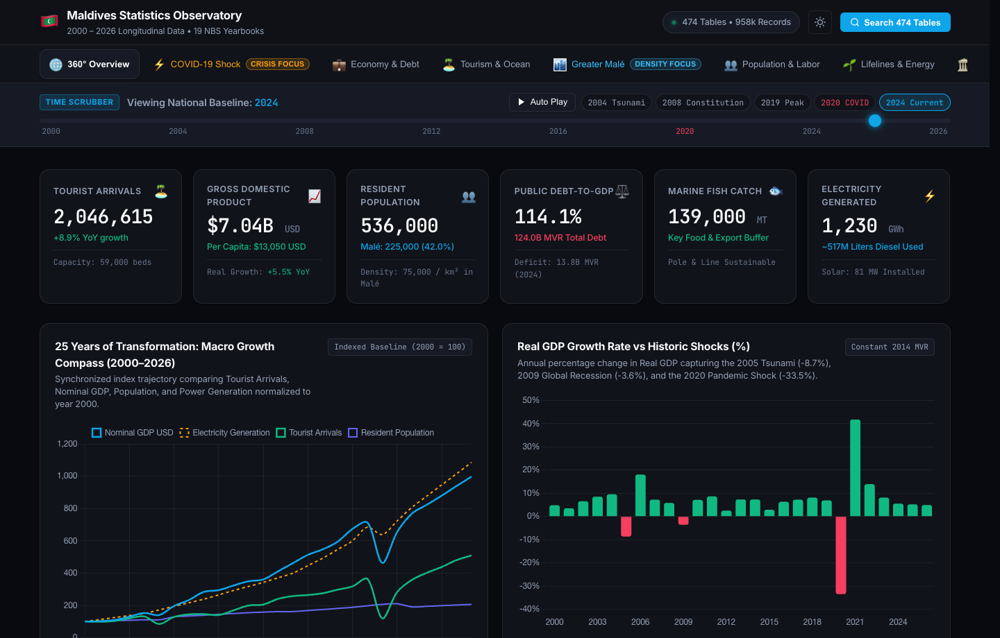

# Maldives National Statistics Observatory (2000–2026)
### Multi-Year Open Data Archive & Interactive Longitudinal Dashboard

[](https://ajmals.github.io/maldives-statistics/)
[](data/raw/)
[](data/processed/multi_year_catalog.json)
[](data/master_categories/)
[](requirements.txt)

> 🚀 **Live Interactive Web Application**: [https://ajmals.github.io/maldives-statistics/](https://ajmals.github.io/maldives-statistics/)

[](https://ajmals.github.io/maldives-statistics/)
*Click the image above to open the live interactive dashboard.*

---

A unified, machine-readable open data repository and interactive observatory synthesized from **19 editions of the official Statistical Yearbook of Maldives (2008–2026)**, published by the **National Bureau of Statistics (NBS)**, Maldives.

This platform bridges the gap between raw government publications and modern computational analysis: transforming **3,937 extracted tabular datasets** into **22 thematic categories**, unifying **958,949 longitudinal observations**, and providing an **interactive client-side dashboard** hosted live on GitHub Pages.

---

## 🌐 Live Interactive Dashboard

For most visitors, the interactive dashboard is the primary way to explore Maldives national statistics without needing code or data wrangling tools:  
👉 **[https://ajmals.github.io/maldives-statistics/](https://ajmals.github.io/maldives-statistics/)**

Built with modern HTML5, Vanilla CSS3, JavaScript, and Chart.js, the dashboard requires **zero installation, zero backend server, and zero build pipeline**.

### 🌟 Key Dashboard Features:
- **360° Longitudinal Macro Timeline (2000–2026)**: Multi-decade synchronization tracking real GDP, tourist arrivals, resorts in operation, government revenue, budget expenditure, fish catch & exports, and CPI inflation.
- **Animated Population Pyramid (1995–2030)**: Interactive year-on-year demographic transitions across 17 age cohorts, featuring official Census milestones (1995, 2000, 2006, 2014) and NBS projections (2014–2030). Includes filters for gender, Maldivian vs. Foreign expat population, and geographic breakdown (Republic, Malé, Atolls).
- **Monthly COVID-19 Shock & Rebound (2019–2021)**: Interactive month-by-month scrubber detailing the border closure, subsequent geopolitical market pivot (India, Russia, Europe), and rapid economic recovery.
- **190-Island Interactive Directory**: Live search, filtering, and multi-parameter sorting across all 190 inhabited administrative islands by population, land area, population density, and distance to Malé.
- **Greater Malé Urban Agglomeration**: Spatial density and demographic growth analytics contrasting Malé Island, Hulhumalé, and Villimalé.
- **Global Benchmarking Suite**: Contextualizes Maldivian density, tourist influx, and economic ratios against international benchmarks (Paris, Manhattan, Manila, Tokyo, Iceland, Singapore).
- **Master Data Catalog Explorer**: Direct keyword and category search across 470+ longitudinal tables with instant links to download clean CSV datasets.

---

## 📄 From Formatted Bureaucracy to Machine-Readable Open Data

### 1. The Reality of the Original Source Data
The official Statistical Yearbooks published by the National Bureau of Statistics (NBS) are an indispensable national record. However, like many government statistical publications globally, they were designed for **visual printing and human reading**, not for software ingestion:

* **Visual Spreadsheets (.xlsx, .xls) & Static PDFs**: Built for human page layouts with decorative banners, multi-tiered merged title headers, embedded logos, and explanatory footnotes mixed into numeric rows.
* **The Legacy Font Barrier (Non-Unicode Thaana)**: In editions published between 2008 and 2015, Dhivehi (Thaana) script was typed using standard English ASCII keystrokes styled with proprietary fonts (*Faruma*, *Faseyha*, *Randhoo*, *Waheed*). When loaded in modern programming environments without those specific fonts installed, text renders as corrupted gibberish strings (e.g., `clwvwt`, `cnunemihob`).
* **Multi-Layer Merged Cells**: Tables frequently feature 2 to 4 levels of vertically and horizontally merged cells (e.g., year headers spanning sub-categories like `Male`, `Female`, `Total`). Standard data tools (`pd.read_csv`, SQL importers, BI tools) fail or mangle these structures.
* **Fragmented Annual Snapshots**: Each yearbook publishes a discrete, backward-looking slice of data (e.g., a 5-year or 10-year window). Investigating a 25-year trend previously required opening a dozen separate workbooks and reconciling conflicting revisions by hand.

### 2. Why We Needed Cleaned, Processed Data
Computational analysis requires **tidy tabular data**:
* **One observation per row, one variable per column.**
* **Unambiguous column names** without merged hierarchy or decorative artifacts.
* **Clean data types**: numbers represented as pure floats/integers without currency symbols, thousand commas, or mixed footnote characters (`*`, `na`, `...`, `-`).
* **UTF-8 Unicode encoding**: pure English metadata paired with standard Unicode text.
* **Longitudinal harmonization**: merging overlapping editions into continuous time-series where latest official revisions automatically supersede preliminary estimates.

### 3. Who Needs Machine-Readable Data?
While casual explorers and general citizens benefit most from the visual **Interactive Dashboard**, machine-readable open data is critical for:

* **Independent & Hobby Researchers (Dismantling Gatekeeping)**: There is a persistent misconception within the Maldivian community and government bureaucracy that "research" is strictly the domain of formal institutions—ministries, large NGOs, university faculties, or well-funded consultancies. Consequently, individual citizens, curious hobbyists, and self-directed researchers are often gatekept or denied access to raw official records. This repository fundamentally affirms that **public data belongs to the public**: an individual exploring fisheries trends, tracking island demographic transitions, or analyzing energy consumption from their bedroom has every right to clean, frictionless national data. True open data democratizes insight.
* **Economists & Policy Researchers**: Running econometric regressions, debt-sustainability models, and GDP impact assessments.
* **Data Journalists**: Verifying government fiscal reports, demographic changes, and historical trends with reproducible, verifiable evidence.
* **Data Scientists & Civic Developers**: Building community apps, specialized visual models, or open civic tools without bureaucratic barriers.
* **Students & Academics**: Conducting rigorous studies on small-island developing states (SIDS), climate vulnerability, and archipelagic logistics.
* **AI & Language Model Systems**: Providing reliable, structured context for retrieval-augmented generation (RAG) without hallucinating over corrupted legacy font glyphs.

---

## 💻 Accessing the Data

All converted datasets are distributed in standard, open formats (**UTF-8 CSV and JSON**) requiring zero proprietary database software:

### 1. Loading Multi-Year Harmonized CSVs with Python & Pandas
Each of the 22 categories provides harmonized wide tables spanning continuous chronological years:

```python
import pandas as pd

# Load multi-year tourist arrivals by country (2002–2026)
df_tourism = pd.read_csv('data/master_categories/10.0 Tourism/tables/10_1.csv')
print(df_tourism.head())

# Load resident population by island and atoll
df_pop = pd.read_csv('data/master_categories/3.0 Population/tables/3_2.csv')
print(df_pop.head())
```

### 2. Longitudinal Tidy Panel Data
For econometric and panel regression workflows, each category directory contains a long-format `master_panel.csv`:

```python
# Load the complete fisheries panel
df_fish_panel = pd.read_csv('data/master_categories/9.0 Fisheries & Agriculture/master_panel.csv')
print(df_fish_panel[['year', 'item_name', 'metric_name', 'value']].dropna().head())
```

---

## ⚙️ Technical Data Pipeline

The entire ingestion, linguistic font decoding, table cleansing, and longitudinal harmonization process is fully automated via Python scripts located in `scripts/`:

* **`download_yearbooks.py`**: Scrapes and downloads all 19 editions (2008–2026) with concurrent thread pools and URL repair.
* **`process_all_yearbooks.py`**: Extracts, cleans, decodes fonts, and standardizes 3,937 tables into clean CSVs and JSON companion schemas.
* **`build_master_categories.py`**: Merges annual extractions into 22 longitudinal categories, wide time-series CSVs, and panel datasets (with optional local SQLite generation).
* **`prepare_unified_dashboard_data.py`**: Assembles the optimized data payload for the interactive web dashboard.

> 📖 **Deep Dive for Developers & Engineers**:  
> For complete technical architecture, Thaana legacy font decoding algorithms, hierarchical header unmerging logic, and step-by-step CLI execution instructions, please refer to:  
> 👉 **[`DATA_PROCESSING_PIPELINE.md`](DATA_PROCESSING_PIPELINE.md)**

---

## 📁 Repository Structure

```text
maldives-statistics/
├── index.html                             # Interactive Web Dashboard UI
├── assets/                                # Frontend dashboard assets
│   ├── app.js                             # Dashboard state, scrubber & Chart.js logic
│   ├── styles.css                         # Responsive design & theme styling
│   ├── dashboard_screenshot.png           # Visual preview of the interactive dashboard
│   ├── dashboard_data_unified.js          # Synthesized data bundle (JS wrapper)
│   └── dashboard_data_unified.json        # Synthesized multi-year dashboard dataset
├── data/                                  # Multi-year statistical repository
│   ├── raw/                               # Official source files (PDFs, Excel, HTML)
│   │   ├── manifest.json                  # Multi-year collection metadata index
│   │   └── 2026/ ... 2008/                # 19 Yearbook editions (7,147 files, 1.37 GB)
│   ├── processed/                         # Standardized per-year extractions
│   │   ├── multi_year_catalog.json        # Unified master catalog (3,937 tables)
│   │   ├── README.md                      # Multi-year archive index & statistics
│   │   └── 2026/ ... 2008/                # Clean CSVs + JSON schemas + per-year catalogs
│   ├── master_categories/                 # Consolidated 22-category longitudinal archives
│   │   ├── catalog.json                   # Consolidated category catalog metadata
│   │   ├── README.md                      # Category documentation & index
│   │   └── 1.0 Geography ... 22.0/        # Wide time-series CSVs & master_panel.csv
│   └── demographics_pyramid.json          # Demographic cohort & projection series
├── scripts/                               # Data processing & pipeline automation
│   ├── download_yearbooks.py              # Multi-year scraper & downloader (2008-2026)
│   ├── process_all_yearbooks.py           # Unified multi-year table cleaning pipeline
│   ├── build_master_categories.py         # 22-category longitudinal merger & panel builder
│   └── prepare_unified_dashboard_data.py  # Dashboard payload synthesis script
├── DATA_PROCESSING_PIPELINE.md            # Technical data pipeline documentation
├── requirements.txt                       # Python dependencies
├── .gitignore                             # Ignored build artifacts, OS files, and notebooks
└── README.md                              # Project overview
```

---

## 📜 Citation & Attribution
* **Data Source**: National Bureau of Statistics (NBS), Ministry of National Planning, Housing and Infrastructure, Republic of Maldives.
* **Publications**: *Statistical Yearbook of Maldives* (Editions 2008 through 2026).
* **Licensing**: Data is compiled and published under open statistical access terms by the NBS.
